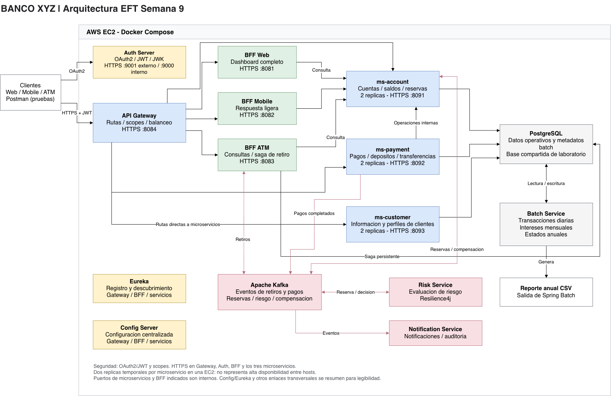
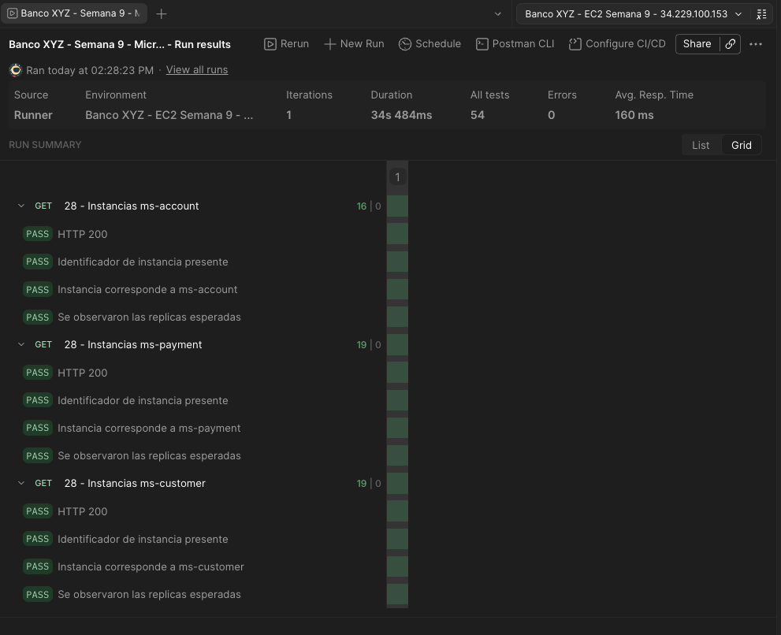

# Banco XYZ - Semana 9 (EFT)

Proyecto de Desarrollo Backend III con Spring Boot 3, Java 21, Spring Cloud, OAuth2/JWT, Resilience4j, Kafka y Docker Compose.

Repositorio: [Desarrollo_Backend_III_Banco_XYZ](https://github.com/Arekkusu17/Desarrollo_Backend_III_Banco_XYZ).

## Arquitectura



[Abrir diagrama editable en draw.io](evidencias/00-arquitectura.drawio).

| Componente | Responsabilidad |
| --- | --- |
| ms-account | Apertura, mantenimiento, cierre, saldos, movimientos y reserva/compensacion |
| ms-payment | Depositos, pagos y transferencias; idempotencia, reintentos y outbox Kafka |
| ms-customer | Perfiles persistentes de clientes |
| batch-service | Transacciones diarias, intereses mensuales y estados anuales CSV |
| BFF Web / Mobile / ATM | Respuestas por canal y saga persistente de retiro ATM |
| Gateway / Auth / Config / Eureka | Enrutamiento, OAuth2/JWT, configuracion y descubrimiento |
| Kafka / Risk / Notification | Eventos, evaluacion de riesgo y notificaciones |

PostgreSQL compartido conserva datos operativos y metadatos batch. Es una simplificacion de laboratorio, no una arquitectura productiva con bases aisladas.

## Requisitos y ejecucion

Java 21 para Maven y `keytool`; Docker Engine y Compose compatible con `!reset`/`!override` (2.24.4 o posterior); Postman y curl.

```bash
./mvnw verify
docker compose up -d --build --remove-orphans
docker compose ps
```

El comando Compose anterior usa HTTP y solo se recomienda para desarrollo local. En EC2 seguir el procedimiento HTTPS de [despliegue](entregables/despliegue.md). Si el puerto 9000 esta ocupado, exportar `AUTH_SERVER_PORT=9001` antes de ejecutar Compose y ajustar Postman; el puerto interno sigue siendo 9000.

## Documentacion de entrega

- [Instrucciones y pruebas](entregables/instrucciones.md): OAuth2, Postman, operaciones, batch y recuperacion.
- [Despliegue S3 y EC2](entregables/despliegue.md): requisitos, instalacion, HTTPS y demostracion temporal de escalabilidad.

Este README es el unico README general de entrega. El informe tecnico y el video estan pendientes; no se incluyen en esta etapa.

Las capturas de Semana 9 estan organizadas en [despliegue](evidencias/despliegue/) (EC2, contenedores, Security Group y S3) y [pruebas](evidencias/pruebas/) (Postman, batch, escalabilidad, Kafka, Resilience4j y Eureka). Los documentos de semanas anteriores son antecedentes, no resultados de esta EFT.

## Validacion

| Verificacion | Resultado registrado |
| --- | --- |
| Tests locales | 56 unitarios y 4 de integracion de recuperacion batch |
| EC2, 11 de octubre de 2026 | HTTPS, scopes, BFFs, ATM, clientes, cuentas, pagos y batch validados |
| Escalabilidad | Dos instancias observadas por microservicio; carpeta 28 con todos los tests Passed |



La corrida utilizo 12 muestras por servicio. Comprueba distribucion de lecturas, no rendimiento bajo carga ni alta disponibilidad entre hosts. Las pruebas de integracion locales requieren una base aislada; sin sus variables Maven las omite.

## Puertos

EC2 validada: Gateway `https://34.229.100.153:8084` y Auth `https://34.229.100.153:9001`.

| Servicio | Puerto del host |
| --- | --- |
| Auth Server | 9000 por defecto; 9001 en la EC2 validada |
| Gateway | 8084 |
| BFF Web / Mobile / ATM | 8081 / 8082 / 8083 |
| ms-account / ms-payment / ms-customer | 8091 / 8092 / 8093 |
| Batch / Risk / Notification | 8080 / 8090 / 8085 |
| Config / Eureka | 8888 / 8761 |
| PostgreSQL / Kafka externo | 5432 / 29092 |

Los tres microservicios dejan de publicar puertos directos al aplicar `docker-compose.scale.yml`. En ese modo se prueban a traves del Gateway. No abrir PostgreSQL, Kafka ni las consolas administrativas a Internet.


## Alcance

Los tres CSV EFT tienen 1000 registros cada uno y proceden de [fin_legacy_data](https://github.com/KariVillagran/fin_legacy_data). No hay COBOL ejecutable ni pruebas de carga: no se afirma equivalencia medida contra el legacy o mejora de rendimiento. Las proyecciones se presentan como estimaciones.

El escalado a dos replicas es temporal; la pauta no exige mantenerlas permanentemente. Resilience4j se evidencia en estado CLOSED, sin demostrar el ciclo de apertura y recuperacion.
