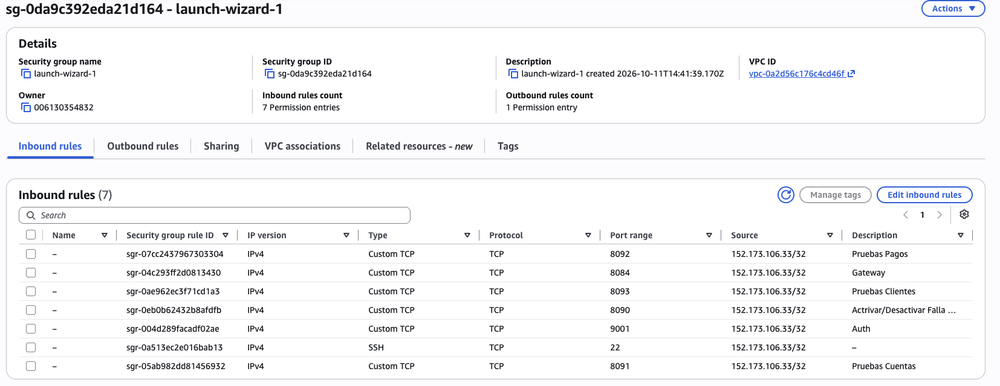
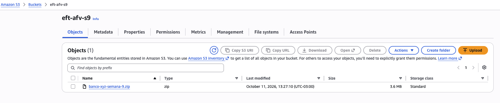
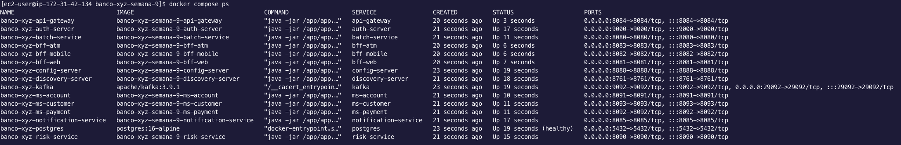
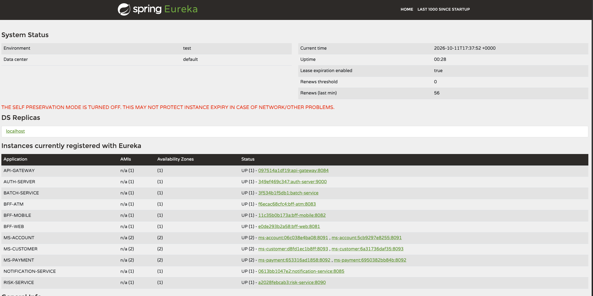

# Despliegue de Banco XYZ EFT: ZIP, S3 y EC2

## Alcance y estado

Procedimiento academico: subir codigo como ZIP a S3, descargarlo en una EC2 y ejecutar Docker Compose. No se requiere ECR, ECS, Kubernetes, balanceador AWS ni un pipeline de despliegue.

La validacion funcional y el escalado en EC2 se completaron el 11 de octubre de 2026, segun las corridas y capturas obtenidas.

| Recurso | Configuracion validada |
| --- | --- |
| EC2 | Amazon Linux 2023; IP publica 34.229.100.153 |
| S3 | Bucket privado eft-afv-s9; banco-xyz-semana-9.zip |
| Proyecto | $HOME/banco-xyz-semana-9 |
| Acceso HTTPS | Gateway 8084; Auth externo 9001, interno 9000 |
| Runtime | Docker Compose 2.29.7 y Java 21 |

Recorrido: **ZIP local → S3 privado → EC2 → Docker Compose → pruebas Postman**.

## 1. Requisitos EC2

| Item | Recomendacion inicial |
| --- | --- |
| AMI | Amazon Linux 2023, arquitectura x86_64 |
| Instancia | t3.large: 2 vCPU y 8 GiB RAM; ampliar si hay falta de memoria |
| Disco | EBS gp3 de 30 GiB o mas |
| Red | Subred publica, IPv4 publica, Internet Gateway y salida a Internet |
| Acceso | Key pair SSH y Security Group restringido a la IP de pruebas |
| IAM | Rol de instancia con s3:GetObject para el ZIP; s3:ListBucket solo si se necesita listar |
| Software | Docker Engine, Docker Compose 2.24.4 o posterior, AWS CLI, unzip, curl, jq y Java 21/keytool |

El dimensionamiento es una estimacion, no un resultado de carga. Limitar concurrencia durante el build y observar memoria/OOM al escalar; ampliar capacidad si es insuficiente.

[Ver configuracion de la EC2 utilizada](../evidencias/despliegue/01-configuracion-ec2.png).

Reglas de entrada TCP, siempre desde la IP publica de pruebas con mascara /32:

| Puerto | Uso |
| --- | --- |
| 22 | SSH |
| 8084 | Gateway HTTPS |
| 9001 | Auth HTTPS; 9000 si se elige el puerto predeterminado |
| 8091, 8092, 8093 | Opcional y temporal: coleccion Postman con acceso directo |
| 8090 | Opcional y temporal: simulacion de riesgo por Postman (HTTP) |

No abrir 5432, 9092, 29092, 8888, 8761, 8080 ni 8085 a Internet. BFFs se prueban por Gateway. Inspeccionar Eureka mediante SSH o un tunel, no mediante acceso publico. No usar 0.0.0.0/0 para las reglas anteriores.

El Compose base publica puertos en el host; el Security Group restringe el acceso externo.



*Usar la IP publica actual del equipo de pruebas; no copiar una IP /32 antigua.*

## 2. Preparar ZIP local

Requisitos locales: Git, zip/unzip y AWS CLI configurado. Preparar el ZIP despues de revisar y aprobar los cambios, hacer sus commits y validar la version candidata con ./mvnw verify. Desde la raiz del repositorio:

```bash
git status --short
git switch feature/eft-compliance
git rev-parse HEAD
git archive --format=zip --output=../banco-xyz-semana-9.zip HEAD
zip -d ../banco-xyz-semana-9.zip '*.p12' '*.jks' '*.pem' '*.key'
unzip -l ../banco-xyz-semana-9.zip
```

git archive incluye solo el commit, no cambios pendientes, target, output o .git. zip -d excluye keystores y claves; revisar el ZIP y registrar el hash. HTTPS usara certificados nuevos externos al classpath.

Subir al bucket privado utilizado en la demostracion, o reemplazarlo por el propio:

```bash
export BUCKET='eft-afv-s9'
aws s3 cp ../banco-xyz-semana-9.zip "s3://$BUCKET/banco-xyz-semana-9.zip"
```

Usar IAM Role en EC2 que permita obtener el archivo de S3; no copiar credenciales AWS personales ni la llave SSH al ZIP.



## 3. SSH e instalacion (Amazon Linux 2023)

Desde el equipo local:

```bash
chmod 400 llave.pem
ssh -i llave.pem ec2-user@34.229.100.153
```

Dentro de EC2:

```bash
sudo dnf install -y docker unzip jq awscli-2 java-21-amazon-corretto-devel
sudo systemctl enable --now docker
sudo usermod -aG docker "$USER"
```

Cerrar y volver a abrir SSH para aplicar el grupo docker.

Si Compose no esta instalado, instalar una version fijada compatible:

```bash
mkdir -p "$HOME/.docker/cli-plugins"
curl -fSL https://github.com/docker/compose/releases/download/v2.29.7/docker-compose-linux-x86_64 \
  -o "$HOME/.docker/cli-plugins/docker-compose"
chmod +x "$HOME/.docker/cli-plugins/docker-compose"
docker compose version
docker version
java -version
aws --version
```

2.29.7 es una version fijada para esta guia, no se afirma que sea la mas reciente.

## 4. Descargar y descomprimir

Dentro de EC2:

```bash
export BUCKET='eft-afv-s9'
aws s3 cp "s3://$BUCKET/banco-xyz-semana-9.zip" "$HOME/banco-xyz-semana-9.zip"
mkdir -p "$HOME/banco-xyz-semana-9"
unzip "$HOME/banco-xyz-semana-9.zip" -d "$HOME/banco-xyz-semana-9"
cd "$HOME/banco-xyz-semana-9"
chmod +x mvnw
```

Este procedimiento es para la primera instalacion. Para actualizar el stack existente, conservar la carpeta y el nombre del proyecto Compose; cambiarlo puede hacer que se use otro volumen PostgreSQL. Revisar los archivos que se reemplazan y conservar output/tls.

> `Unable to locate credentials` indica que falta una identidad AWS disponible: asignar a EC2 el rol IAM autorizado para S3. `AccessDenied` indica revisar permisos del rol y del objeto.

## 5. Certificados y arranque HTTPS

Antes del primer arranque, reemplazar la IP y elegir una clave de laboratorio sin compartirla:

```bash
export TLS_PUBLIC_IP='34.229.100.153'
read -rsp 'Clave para el almacen TLS: ' TLS_STORE_PASSWORD
export TLS_STORE_PASSWORD
printf '\n'
export AUTH_SERVER_PORT=9001
TLS_COPY_BFF=false bash scripts/generar-certificados.sh
export COMPOSE_FILE=docker-compose.yml:docker-compose.secure.yml
docker compose config --quiet
COMPOSE_PARALLEL_LIMIT=1 docker compose build
docker compose up -d --remove-orphans
docker compose ps
```

El script genera bank.p12, truststore.p12 y bank.crt en output/tls, montados de solo lectura. TLS_COPY_BFF=false evita copiar claves al codigo fuente. Al reconectar SSH, restaurar COMPOSE_FILE, AUTH_SERVER_PORT, TLS_PUBLIC_IP y la misma clave; nunca guardarla en el repo.



*Captura del arranque inicial, con Auth publicado en 9000. La configuracion final usa 9001 y dos replicas por microservicio. Running no implica salud ni configuracion lista.*

<details>
<summary>Rotar certificados o recuperar una clave olvidada</summary>

Detener el stack sin -v, conservar output/tls y regenerar con TLS_REGENERATE=true. El script prepara el nuevo juego y respalda el anterior en output/tls/backup.*. Si se olvido la clave, elegir una nueva de al menos seis caracteres; la rotacion completa no requiere la anterior.

Con el override de escalabilidad, incluir TLS_SCALE_NETWORK=true para conservar la cobertura del pool. Arrancar todos los servicios TLS con la nueva clave y reimportar el certificado publico en Postman.

</details>

<details>
<summary>Diagnosticar arranque, memoria o rutas 404</summary>

Los servicios arrancan asincronamente. Comprobar salud y logs antes de continuar:

```bash
docker compose logs --tail=100 config-server discovery-server auth-server api-gateway batch-service
docker stats --no-stream
free -h
df -h
curl --fail --cacert output/tls/bank.crt https://localhost:8084/actuator/health
curl --fail --cacert output/tls/bank.crt https://localhost:8091/actuator/health
curl --fail --cacert output/tls/bank.crt https://localhost:8092/actuator/health
curl --fail --cacert output/tls/bank.crt https://localhost:8093/actuator/health
```

Las consultas directas a 8091/8092/8093 solo funcionan sin el override de escalabilidad. En modo escalado usar el Gateway. Consultar Eureka desde EC2 con curl http://localhost:8761/eureka/apps -H 'Accept: application/json' y esperar registros UP; Config Server no se registra como cliente Eureka.

Un Gateway con estado global UP pero clientConfigServer UNKNOWN y "no property sources located" no confirma que las rutas esten cargadas. Comprobar primero Config Server:

```bash
curl --fail http://localhost:8888/actuator/health
curl --fail http://localhost:8888/api-gateway/default
```

La segunda respuesta debe incluir propertySources con classpath:/config-repo/api-gateway.yml y las rutas. Si Config Server ya esta disponible pero el Gateway no las cargo al arrancar, ejecutar `docker compose restart api-gateway` y volver a comprobar su salud: clientConfigServer debe estar UP y mostrar la fuente cargada. No reiniciar todo el stack por este caso.

</details>

## 6. Pruebas desde Postman y EC2

Descargar solo el certificado publico al equipo local:

```bash
scp -i llave.pem ec2-user@34.229.100.153:~/banco-xyz-semana-9/output/tls/bank.crt ./banco-xyz-ec2.pem
```

En Postman, Settings > Certificates > CA Certificates: activar e importar banco-xyz-ec2.pem. Mantener SSL certificate verification activado.

Importar la [coleccion](../postman/Banco_XYZ_Semana_9.postman_collection.json) y el [environment EC2](../postman/Banco_XYZ_EC2_Semana_9.postman_environment.json). Seleccionar el entorno y actualizar URLs si cambia la IP.

Seguir los bloques de [instrucciones](instrucciones.md#5-postman-y-regresion-funcional), incluidos SQL/CSV batch. Validar primero con una instancia y luego escalar. Batch se consulta por tunel en localhost:18080; desactivar la falla de riesgo al terminar.

> Si localhost responde pero Postman tiene timeout TCP, revisar docker compose port auth-server 9000, el puerto del Security Group y la IP /32 actual. La conexion falla antes de validar TLS; no desactivar su verificacion.

## 7. Escalabilidad temporal de los tres microservicios

El criterio 6 de la pauta solicita Docker y escalabilidad horizontal de tres microservicios en la nube. No fija dos replicas permanentes. Esta demostracion usa dos temporalmente en una EC2; no demuestra alta disponibilidad entre hosts.

docker-compose.scale.yml elimina los nombres y puertos fijos y anuncia IP individuales en Eureka. TLS cubre el pool completo, incluso si cambian las IP de los contenedores.

| Red | Valor |
| --- | --- |
| Subnet | 172.30.90.0/24 |
| Pool de asignacion y cobertura TLS | 172.30.90.0/26: 64 direcciones |
| Gateway Docker | 172.30.90.254 |

Antes de cambiar la red, revisar que 172.30.90.0/24 no se superponga con otra red Docker ni con rutas de la VPC/VPN. Si hay conflicto, no ejecutar la migracion: modificar el pool y su cobertura TLS juntos. Revisar las redes y rutas con:

```bash
docker network inspect $(docker network ls -q) \
  --format '{{.Name}} {{json .IPAM.Config}}'
ip route
```

Conservar TLS_PUBLIC_IP (la IP publica de EC2), TLS_PUBLIC_DNS si se utilizo, TLS_STORE_PASSWORD y AUTH_SERVER_PORT con los mismos valores del despliegue. El cambio de IPAM requiere recrear la red. Hay una interrupcion temporal del stack; el comando down SIN -v conserva el volumen de PostgreSQL, pero no garantiza conservar el historial de Kafka. No cambiar el directorio ni el nombre del proyecto Compose, que identifican ese volumen. No usar --volumes, prune ni borrar output/tls.

```bash
export COMPOSE_FILE=docker-compose.yml:docker-compose.secure.yml:docker-compose.scale.yml
docker compose config --quiet
docker compose down --remove-orphans
unset TLS_EXTRA_IPS
TLS_SCALE_NETWORK=true TLS_REGENERATE=true TLS_COPY_BFF=false \
  bash scripts/generar-certificados.sh
```

Solo si la generacion termina correctamente, iniciar el stack en la red nueva. No reconstruir imagenes Java para este cambio:

```bash
docker compose up -d --remove-orphans \
  --scale ms-account=2 --scale ms-payment=2 --scale ms-customer=2
docker compose ps
docker stats --no-stream
docker inspect $(docker compose ps -q ms-account ms-payment ms-customer) \
  --format '{{.Name}} {{range .NetworkSettings.Networks}}{{.IPAddress}} {{end}}'
```

Verificar seis contenedores con IP distintas dentro del pool 172.30.90.0-63 y dos registros UP por microservicio en Eureka. No avanzar si hay IP fuera del pool. Esperar arranque y propagacion; una importacion inicial opcional del Config Server puede requerir reiniciar el Gateway una vez que Config Server este disponible.

Reimportar output/tls/bank.crt en Postman y mantener SSL certificate verification activado. No hace falta regenerar por cada reinicio ni al reducir replicas mientras las IP permanezcan en el pool. El certificado compartido es solo de laboratorio; no publicar claves privadas.

Realizar la regresion breve de Postman: 01 UP; 02 y 04 tokens nuevos; 03 y 05 rechazos 401/403; 06 y 24 datos reales sin fallback; 19 y 23 listados por Gateway. Luego ejecutar la carpeta 28 completa. No repetir operaciones de escritura ni todos los bloques funcionales por este cambio de infraestructura.



Esperar propagacion al Gateway y ejecutar carpeta 28 con token 02 vigente, enableScalingChecks=true y expectedInstances=2. Usar Runner: una iteracion y 1000 ms de intervalo. La corrida validada uso scalingSamples=12 y observo dos IDs por servicio, con todos los tests Passed; seis es el valor predeterminado. Ver [resultado Postman](../evidencias/pruebas/34-runner-escalabilidad.png).

En modo escalado usar Gateway: 8091/8092/8093 no estan publicados. La carpeta no crea replicas ni mide carga. Desactivar enableScalingChecks al terminar.

<details>
<summary>Volver a una replica o retirar el override de escalabilidad</summary>

Volver a una replica manteniendo el override y el pool cubierto por TLS:

```bash
docker compose up -d --remove-orphans \
  --scale ms-account=1 --scale ms-payment=1 --scale ms-customer=1
```

En ese modo siguen sin puertos directos. Para volver a la configuracion inicial con puertos directos y red automatica, retirar primero la red acotada, conservando los datos:

```bash
docker compose down --remove-orphans
export COMPOSE_FILE=docker-compose.yml:docker-compose.secure.yml
docker compose up -d --remove-orphans
```

Esperar convergencia de Eureka. No ejecutar docker compose down -v durante las transiciones. Comprobar nuevamente saldo y listado de pagos/clientes.

</details>

## 8. Cierre

La validacion no demuestra rendimiento bajo carga, equivalencia ejecutada contra COBOL ni alta disponibilidad entre hosts.

Para detener los contenedores conservando PostgreSQL:

```bash
docker compose down --remove-orphans
```

Detener EC2 cuando no se use y revisar recursos/costos restantes (EBS, IPv4, snapshots y S3). No eliminar volumenes o evidencia necesaria. La persistencia de Kafka al eliminar contenedores no esta garantizada.
