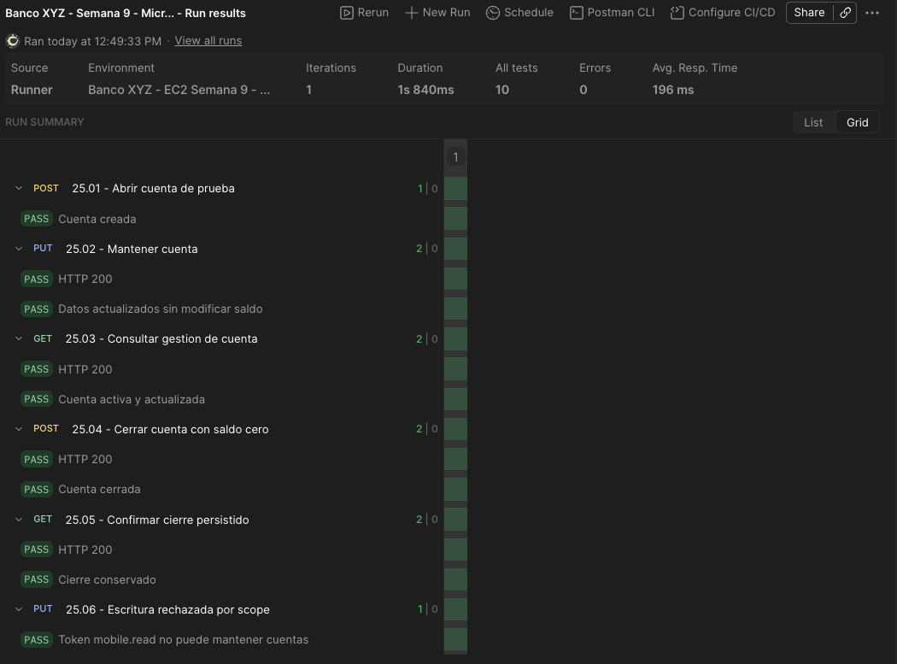
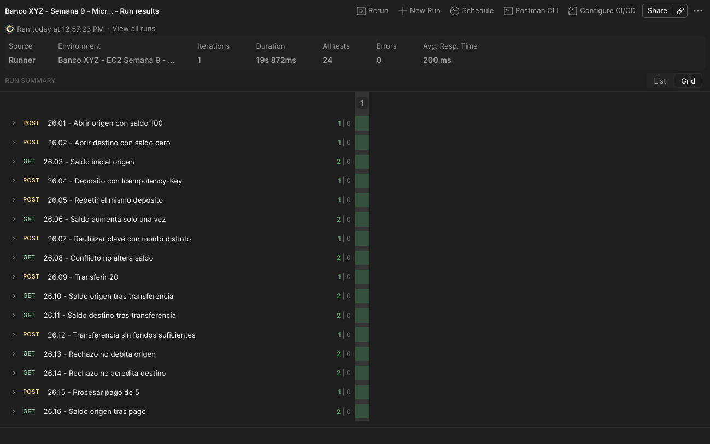
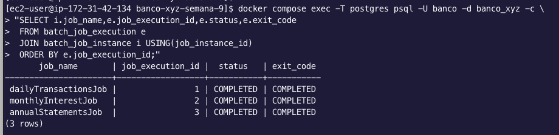

# Instrucciones de ejecucion y pruebas - Banco XYZ EFT

## 1. Version y requisitos

Trabajar con `feature/eft-compliance` mientras el PR no este aprobado. Requisitos: Java 21, Docker, Compose 2.24.4 o posterior, curl, jq y Postman. No usar un volumen con datos importantes para pruebas destructivas.

La validacion funcional en EC2 y la carpeta 28 de escalabilidad se completaron el 11 de octubre de 2026, segun las corridas y capturas obtenidas. Esta guia permite reproducirlas; repetir escrituras modifica datos. El informe tecnico y el video siguen pendientes.

```bash
git clone --branch feature/eft-compliance https://github.com/Arekkusu17/Desarrollo_Backend_III_Banco_XYZ.git
cd Desarrollo_Backend_III_Banco_XYZ
./mvnw verify
```

Si ya existe el checkout, no volver a clonarlo. Revisar primero los cambios locales antes de cambiar de branch. La guia [S3 y EC2](despliegue.md) permite probar la misma version desde un ZIP, sin instalar Git en la instancia.

## 2. Arranque local y HTTPS

Para desarrollo local HTTP:

```bash
export AUTH_SERVER_PORT=9001
docker compose up -d --build --remove-orphans
docker compose ps
```

9001 es opcional y solo cambia el puerto publicado del Auth Server.

Para HTTPS de laboratorio, con una instancia por microservicio:

```bash
read -rsp 'Clave para el almacen TLS: ' TLS_STORE_PASSWORD
export TLS_STORE_PASSWORD
printf '\n'
TLS_COPY_BFF=false bash scripts/generar-certificados.sh
export COMPOSE_FILE=docker-compose.yml:docker-compose.secure.yml
docker compose up -d --build --remove-orphans
curl --cacert output/tls/bank.crt https://localhost:8084/actuator/health
```

Certificados autofirmados de laboratorio: el script conserva los existentes. Para rotacion y cobertura TLS de replicas, seguir [despliegue](despliegue.md#5-certificados-y-arranque-https). Nunca publicar la clave privada; reimportar la CA en Postman tras regenerarla.

El Gateway, Auth Server, BFFs y los tres microservicios usan HTTPS con el override seguro. Risk, Batch y Notification siguen con HTTP en sus puertos; Eureka y Config Server tambien. JWT se valida contra el emisor interno `https://auth-server:9000`, aunque el cliente obtenga el token mediante localhost o la IP EC2.

## 3. Salud y diagnostico

```bash
docker compose ps
curl --fail --cacert output/tls/bank.crt https://localhost:8084/actuator/health
```

| Comprobacion | Resultado esperado |
| --- | --- |
| Gateway | status UP |
| clientConfigServer | UP; fuente configserver:classpath:/config-repo/api-gateway.yml |
| Eureka | Servicios UP; dos instancias por microservicio durante el escalado |
| Backend Web/Mobile | Datos reales; no respuesta fallback |

Running no implica listo. En modo escalado consultar por Gateway, no por los puertos directos 8091/8092/8093.

<details>
<summary>Gateway sin rutas, Config Server UNKNOWN o timeout</summary>

```bash
curl --fail http://localhost:8888/actuator/health
curl --fail http://localhost:8888/api-gateway/default
```

Si Config Server ya devuelve las rutas en propertySources y el Gateway no las cargo, ejecutar docker compose restart api-gateway y repetir su health. Config Server no aparece como cliente en Eureka. Un timeout TCP desde Postman, con localhost disponible, requiere revisar conectividad y Security Group antes de atribuirlo al certificado.

</details>

## 4. Token y seguridad

Ejemplo HTTPS con jq:

```bash
TOKEN=$(curl --fail --silent --show-error --cacert output/tls/bank.crt \
  -u banco-xyz-demo:demo-secret \
  --data-urlencode 'grant_type=client_credentials' \
  --data-urlencode 'scope=web.read mobile.read atm.read atm.write risk.read account.read account.write payment.read payment.write customer.read customer.write' \
  https://localhost:9001/oauth2/token | jq -er '.access_token')
curl --fail --cacert output/tls/bank.crt \
  -H "Authorization: Bearer $TOKEN" \
  https://localhost:8084/gateway/cuentas/119/saldo
```

Si no se configuro 9001, usar 9000. Para HTTP local quitar `--cacert` y cambiar el esquema.

Validar 401 sin token, 403 con un token valido sin el scope de la ruta y acceso permitido con el scope correspondiente. `invalid_scope` implica que se solicito un scope no autorizado para ese cliente. La coleccion solicita solo scopes registrados. `account.execute` es exclusivo del cliente interno `ms-payment`, no del cliente demo.

Los secretos incluidos son de laboratorio. Este procedimiento no convierte la configuracion en una solucion productiva de gestion de secretos.

## 5. Postman y regresion funcional

1. Importar la [coleccion Semana 9](../postman/Banco_XYZ_Semana_8.postman_collection.json) (conserva el nombre de archivo Semana_8; contiene 54 requests) y el [environment EC2](../postman/Banco_XYZ_EC2_Semana_9.postman_environment.json).
2. Seleccionar el entorno EC2: IP 34.229.100.153, cuentas 119/121 y cliente 119/Alice Brown. Actualizar URLs si cambia la IP; los antiguos IDs 101/102 no tienen cuentas validas en esta importacion.
3. Importar bank.crt o banco-xyz-ec2.pem en Settings > Certificates > CA Certificates; mantener SSL certificate verification activado. No usar Client Certificates ni introducir claves privadas.
4. Obtener tokens nuevos con 02 y 04. Se guardan en la coleccion, no en el environment.

Para pruebas locales ajustar las URLs: HTTPS en Auth/Gateway/microservicios y HTTP en Risk. El test 06 exige backend disponible y cuenta poblada; un fallback HTTP 200 no aprueba la prueba funcional.

Probar por bloques, en este orden. En Runner usar una iteracion y un intervalo de 1000 ms; repetir solo consultas asincronas hasta el estado terminal, no solicitudes de escritura:

| Bloque | Prueba y resultado importante |
| --- | --- |
| Seguridad y BFF | 01 salud; 02 token general; 04 token limitado; 03 devuelve 401 y 05 devuelve 403. 06 Web y 24 Mobile deben tener backend disponible, sin fallback |
| ATM | Registrar saldo inicial, desactivar falla con 12, crear un retiro con 07 y consultar 08 hasta CONFIRMED; comprobar debito unico. Activar falla de riesgo, crear otro retiro y consultar hasta RISK_REJECTED; esperar compensacion y saldo restaurado. Desactivar siempre la falla con 12 |
| Clientes | Crear, consultar y listar el cliente por Gateway; 23 devuelve el listado |
| Gestion de cuentas | Ejecutar carpeta 25 completa; cuenta nueva, mantenimiento, cierre con saldo cero y rechazo por scope |
| Pagos | Ejecutar carpeta 26 completa; deposito, idempotencia, conflicto, transferencia, fondos insuficientes y pago |
| Batch | Activar enableBatchChecks, abrir tunel SSH y ejecutar carpeta 27; completar revision SQL y CSV de la seccion 6 |
| Escalabilidad | Escalar antes con Compose, obtener token 02 y ejecutar solo carpeta 28; comprobar dos instancias distintas por servicio |

> Ejecutar cada carpeta en orden. Repetir escrituras modifica saldos; para estados asincronos repetir solo GET. Desactivar siempre la falla de riesgo con 12, incluso si una prueba falla.

### Gestion de cuentas: carpeta 25



*Cuenta creada, actualizada y cerrada con saldo cero; escritura sin scope rechazada.*

### Pagos e idempotencia: carpeta 26



La carpeta crea dos cuentas propias; no modifica las cuentas base.

| Operacion | Saldo origen / destino |
| --- | --- |
| Apertura | 100 / 0 |
| Deposito de 25 y repeticion con la misma clave | 125 / 0; un solo abono |
| Misma clave, cuerpo distinto | 409; mantiene 125 / 0 |
| Transferencia de 20 | 105 / 20 |
| Transferencia de 500 sin fondos | 409; mantiene 105 / 20 |
| Pago de 5 | 100 / 20 |

### Escalabilidad: carpeta 28


| Variable / control | Valor para repetir la demostracion |
| --- | --- |
| enableScalingChecks | true; escalar Docker antes y obtener token 02 |
| expectedInstances | 2 |
| scalingSamples | 12 en la corrida validada; 6 por defecto |
| Runner | Una iteracion; intervalo 1000 ms; solo carpeta 28 |
| Resultado | Dos IDs distintos en cada variable ms-account.observedInstances, ms-payment.observedInstances y ms-customer.observedInstances de la coleccion |

Send no ejecuta el muestreo completo. scalingSamples indica lecturas, no replicas ni carga. Si se interrumpe Runner, borrar las tres variables ms-account.sampleCount, ms-payment.sampleCount y ms-customer.sampleCount antes de repetir. Desactivar enableScalingChecks al terminar.

Para Batch usar el [tunel SSH de la seccion 8](#8-alcance-de-rendimiento-y-evidencias): batchBaseUrl=http://localhost:18080 y enableBatchChecks=true. La carpeta 27 obtiene su token core.read con el cliente bff-web; no abrir 8080 en el Security Group. Desactivar enableBatchChecks al terminar. Completar SQL y CSV: los conteos HTTP no prueban todos los resultados.

<details>
<summary>Cuerpos de operaciones y comprobacion manual de persistencia</summary>

Para cuentas: accountId, customerName, accountType, age, initialBalance. Para transferencias: sourceAccountId, targetAccountId, amount, description. La repeticion sin Idempotency-Key puede crear otra operacion. Para comprobar persistencia, completar una operacion, reiniciar solo el servicio correspondiente y verificar que conserva su estado.

</details>

## 6. Batch y resultados

Los tres jobs se lanzan al iniciar batch-service. La clave predeterminada es la fecha del arranque; una instancia ya COMPLETED no se reprocesa con los mismos parametros.

```bash
docker compose logs --tail=150 batch-service
docker compose exec -T postgres psql -U banco -d banco_xyz -c \
  "SELECT i.job_name,e.job_execution_id,e.status,e.exit_code FROM batch_job_execution e JOIN batch_job_instance i USING(job_instance_id) ORDER BY e.job_execution_id;"
docker compose exec -T postgres psql -U banco -d banco_xyz -c \
  "SELECT 'daily' AS proceso,COUNT(*) FROM daily_transaction_summary UNION ALL SELECT 'interest',COUNT(*) FROM monthly_interest_results UNION ALL SELECT 'annual',COUNT(*) FROM annual_statement_entries;"
docker compose exec -T postgres psql -U banco -d banco_xyz -c \
  "SELECT process_name,reason,COUNT(*) FROM rejected_records GROUP BY process_name,reason ORDER BY process_name,reason;"
docker compose cp batch-service:/app/output/annual_statement_report.csv ./annual_statement_report.csv
```

Comprobar tres jobs COMPLETED, workers por particion, registros aceptados/rechazados y reporte anual generado. Los 1000 registros por CSV no implican 1000 resultados validos: aplicar reglas de rechazo y duplicados.



*El estado de los jobs complementa los conteos de Postman. [Ver reporte CSV generado](../evidencias/pruebas/32-batch-csv-generado.png).*

Comparar con valores esperados calculados independientemente a partir del CSV y las reglas del codigo: tipos y limite de anomalia para transacciones, tasas/edad para intereses, formato/tipos/duplicados para estados anuales. Comparar importes con precision decimal, totales y rechazos. No existe un COBOL ejecutable para comparar; una corrida Java sin fallos solo es referencia para verificar recuperacion, no prueba de correccion frente al legacy.

## 7. Pruebas automatizadas de fallos

La ultima validacion local paso 56 tests unitarios y 4 de integracion. Las pruebas verifican checkpoints y equivalencia de tablas, rechazos y CSV tras fallos de proceso o PostgreSQL.

> Nunca detener la base principal para estas pruebas: requieren un PostgreSQL temporal aislado.

<details>
<summary>Repetir las cuatro pruebas de integracion de recuperacion</summary>

Usar exclusivamente este PostgreSQL temporal, sin volumen del stack:

```bash
docker run -d --name banco-eft-recovery-postgres \
  -p 127.0.0.1:25432:5432 \
  -e POSTGRES_DB=banco_recovery_tests -e POSTGRES_USER=banco -e POSTGRES_PASSWORD=banco \
  postgres:16-alpine
docker exec banco-eft-recovery-postgres pg_isready -U banco -d banco_recovery_tests
BATCH_RECOVERY_PG_URL=jdbc:postgresql://localhost:25432/banco_recovery_tests \
BATCH_RECOVERY_PG_CONTAINER=banco-eft-recovery-postgres \
  ./mvnw -pl batch-service -am verify
docker rm -f banco-eft-recovery-postgres
```

Esperar que pg_isready confirme disponibilidad antes de ejecutar Maven. Los tests matan el proceso Java de cada job despues de un checkpoint y detienen/arrancan solo ese PostgreSQL temporal. Verifican reanudacion, ausencia de reproceso de chunks confirmados y equivalencia de tablas, rechazos y CSV con la corrida sin fallos. Otro test impide apropiarse de un job con propietario activo.

Los reportes quedan en `batch-service/target/failsafe-reports/` y los logs en `batch-service/target/recovery-validation/`. Sin las variables explicitas estos tests se omiten; BUILD SUCCESS por si solo no demuestra que se ejecutaron. No detener el PostgreSQL del stack para repetir estas pruebas.

</details>

## 8. Alcance de rendimiento y evidencias

No se haran pruebas de carga o gran volumen. Las estimaciones deben declarar cantidad de registros, hardware supuesto, paralelismo y limites de CPU, memoria, base de datos e I/O. No afirmar tiempos medidos en EC2 ni aceleracion frente a COBOL sin evidencia.

Conservar version/commit y fecha junto a las capturas. No incluir JWT, claves privadas ni secretos.

Organizacion de las capturas de Semana 9:

| Ubicacion | Contenido |
| --- | --- |
| [Arquitectura draw.io](../evidencias/00-arquitectura.drawio) e [imagen](../evidencias/00-arquitectura.png) | Diagrama general del proyecto |
| [despliegue](../evidencias/despliegue/) | Configuracion EC2, servicios Docker Compose, Security Group y ZIP en S3 |
| [pruebas](../evidencias/pruebas/) | Salud, seguridad, BFFs, ATM, clientes, cuentas, pagos, batch y escalabilidad |
| [Kafka](../evidencias/pruebas/36-logs-kafka.png) | Eventos y consumidores de un retiro |
| [Resilience4j](../evidencias/pruebas/37-resilience4j.png) | Circuito registrado y estado CLOSED; no prueba apertura ni recuperacion |
| [Eureka](../evidencias/pruebas/38-eureka-ui.png) | Registro de servicios y dos replicas UP por microservicio |

Para Batch, Eureka UI y Resilience4j, mantener este tunel desde el equipo local, sin abrir puertos administrativos en el Security Group:

```bash
ssh -i llave.pem -N \
  -L 127.0.0.1:18080:localhost:8080 \
  -L 127.0.0.1:18761:localhost:8761 \
  -L 127.0.0.1:19090:localhost:8090 \
  ec2-user@34.229.100.153
```

Abrir Eureka en http://localhost:18761. En la misma coleccion Postman, consultar GET http://localhost:19090/actuator/circuitbreakers con Bearer {{accessToken}} obtenido por 02. CLOSED evidencia la configuracion, no una prueba del ciclo OPEN/HALF_OPEN/CLOSED.

<details>
<summary>Obtener una nueva captura de eventos Kafka</summary>

Para logs Kafka, ejecutar dentro de EC2:

```bash
docker compose logs --since=10m risk-service notification-service \
  | grep -E 'FundsReserved|RiskApproved|RETIRO CONFIRMADO'
```

Si Kafka fue recreado, los eventos anteriores pueden no existir. Para generar evidencia nueva, obtener token vigente, desactivar falla de riesgo, comprobar fondos y enviar 07 una sola vez; consultar 08 hasta CONFIRMED antes de revisar logs. Esto crea otro retiro y modifica el saldo. No repetir 07 como consulta de estado.

</details>

Las capturas y Markdown deben revisarse antes de sus commits. La entrega final aun requiere el informe tecnico en la plantilla y el video; las pruebas aprobadas no sustituyen esos entregables.

## 9. Detener sin perder datos

```bash
docker compose down --remove-orphans
```

No agregar `-v`: elimina el volumen PostgreSQL. La persistencia de Kafka no esta configurada con un volumen explicito; no prometer conservar su historial despues de eliminar contenedores.
